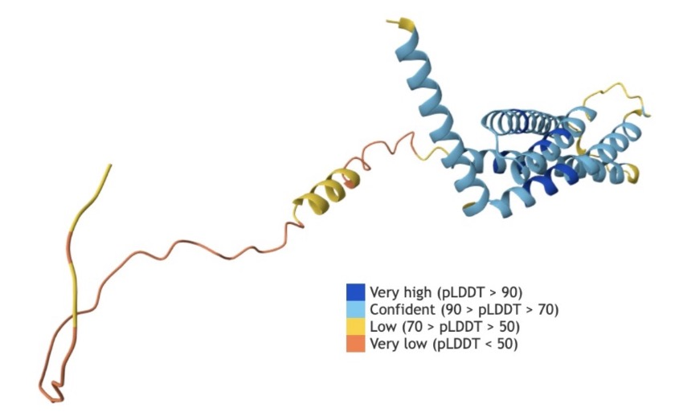
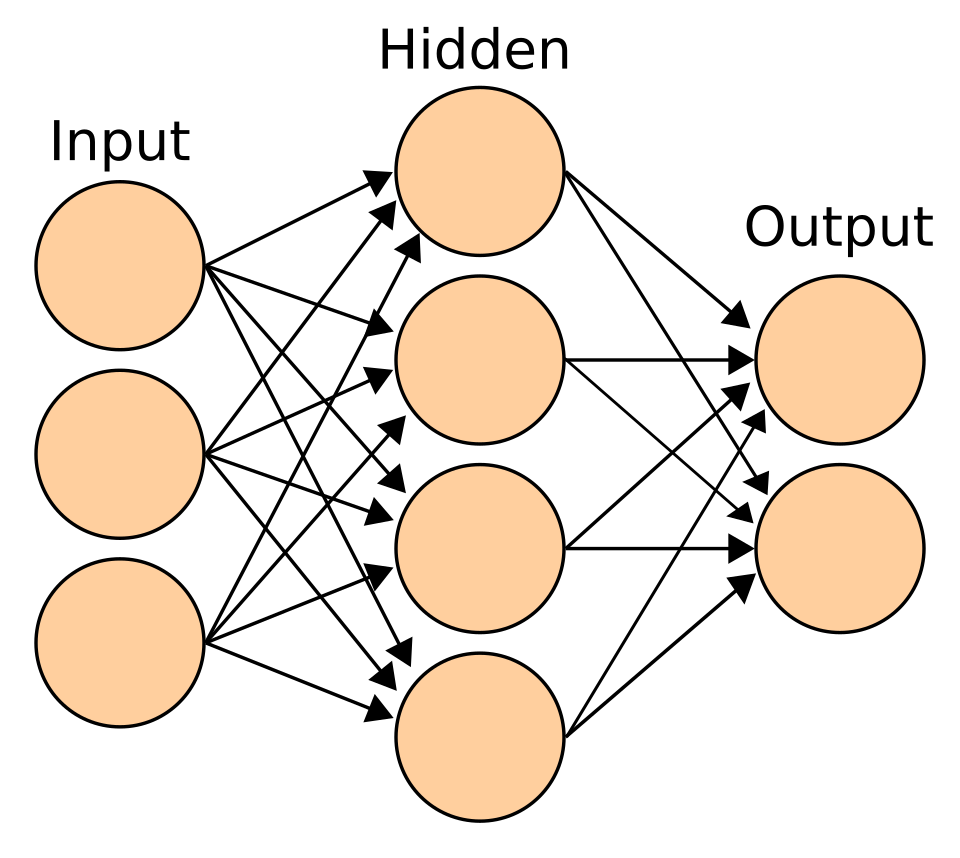
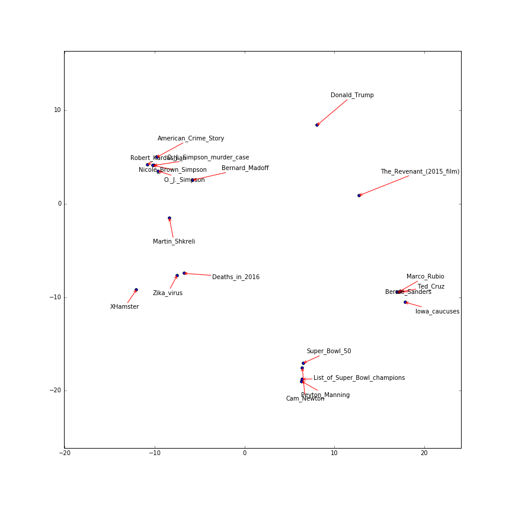

# From Nothing to ChatGPT

*A free digital textbook that follows one thread — from the first tools and the
history of mathematics and machines, through the math of deep learning, to how modern
large language models actually work.*

It is a course, not a blog: the lessons are arranged in six parts, each building on the
last, and the prose is interleaved with **interactive, in-browser visualizations** so
you can *see and touch* the ideas rather than just read about them.

| The Big Bang | The first machines | The modern model |
| :---: | :---: | :---: |
|  |  |  |
| the story begins | Babbage's Analytical Engine | a model that folds a protein |

---

## The six parts

| Part | Title | What it covers |
| :---: | :--- | :--- |
| **1** | **Foundations** | Where we came from, what language is, and the mathematical bedrock beneath AI. |
| **2** | **How Neural Networks Learn** | The learning algorithm step by step — from loss functions to live training. |
| **3** | **Deep Learning & Vision** | Stacking layers, seeing images, and the engineering that makes depth possible. |
| **4** | **The Transformer Revolution** | Attention, embeddings, multimodal models, diffusion, and the post-transformer alternatives. |
| **5** | **Making AI Useful** | Fine-tuning, retrieval, search, safety, and the practical craft of working with LLMs. |
| **6** | **Bigger Questions** | The global AI ecosystem, the displaced prerequisites, and the open problems at the frontier. |

<details>
<summary>The through-line, in two images…</summary>

<p>
  
  
</p>

The left is the machine; the right is what the machine is *about* — words arranged by
meaning in a high-dimensional space.
</details>

---

## What makes it different

- **Interactive, not passive.** Every abstract idea ships with a visualization you can run
  in the browser — a live loss curve, a working backpropagation step, an attention map,
  a t-SNE of word embeddings.
- **Everything runs locally.** No sign-up, no account, no personal data leaves your
  browser. The only outbound telemetry is the anonymous page analytics described
  below — no IPs, no visitor cookies, no persistent IDs.
- **Math-first, intuition-second.** The course does not hand-wave the math; it introduces
  each tool when the reader actually needs it, and shows why.
- **Honest about limits.** It teaches how LLMs work *and* where the folklore stops and
  the mechanism begins (see the *Common Myths and Misconceptions* lesson).

## How it is built

- **PHP templates + vanilla JavaScript**, served statically. No framework, no build step,
  no server-side compute for the lessons. The anonymous analytics store is a small
  local SQLite file (see below).
- **Mathematics** is set with [TeXmacs/Temml](https://temml.org/); **charts** with
  Plotly, ECharts and Three.js; **live training** with TensorFlow.js.
- Every factual claim and every image is **cited** — sources live in
  [`literature.js`](literature.js) and are link-checked in CI.

## Where to read it

The course is served from the same host as the
[asanAI toolkit](https://asanai.scads.ai). Open the repository's `blog/index.php`
(or `blog/index_full.php` for the full linear reading order) to begin.

## Anonymous analytics (admin only)

The blog ships with a privacy-first page analytics system. It counts pageviews,
active visible time, scroll depth, referrers, browser/OS/device categories and
bot traffic. It stores **no IP addresses, no full User-Agent strings, no visitor
cookies, no localStorage/sessionStorage and no persistent visitor ID**.

### One-time setup

1. Create the password file outside the web root. The web server user must be
   able to read it. On this machine Apache runs as `norman`; in Docker it is
   usually `www-data`:

   ```bash
   sudo sh -c 'printf "%s\n" "YOUR_PASSWORD" > /etc/blogpassword && chown root:norman /etc/blogpassword && chmod 640 /etc/blogpassword'
   ```

   A `password_hash()` value is also accepted. Until the file is created,
   every HTML page shows a public setup banner with the current web-server user
   and the exact command (the password placeholder is `YOUR_PASSWORD`; no secret
   is exposed).

2. Make the database directory writable by the web-server user. The default is
   the web-server user's home: `~/.asanai-blog/` (the library creates it when
   the home is writable). The SQLite file is created with mode `660`. If you
   choose another location via `/etc/asanai_blog_path` or
   `blog/lib/analytics_config.php`, make that directory writable by the web
   user. If it is not writable, the setup/health banner shows the exact
   `mkdir`, `chown` and `chmod` commands for the resolved path.

3. Open the dashboard:
   - local: `http://localhost/asanai/blog/stats`
   - live: `<blog-base>/stats` (e.g. `https://asanai.scads.ai/blog/stats`)

4. Sign in. This sets a session cookie for the dashboard, a signed
   admin-indicator cookie (session-only; used for the red health banner on
   content pages) and the optional `mn_stats_exclude` cookie (exclude your own
   visits; on by default after login).

### Where the data lives

By default the database lives in the web-server user's home:

`~/.asanai-blog/analytics.sqlite`

On this machine (Apache runs as `norman`): `/home/norman/.asanai-blog/analytics.sqlite`.
In Docker (user `www-data`): `/var/www/.asanai-blog/analytics.sqlite` (the image
creates that directory).

Resolution order (highest first):

1. `MN_ANALYTICS_DB` environment variable — full path to the `.sqlite` file.
2. `/etc/asanai_blog_path` — one path per file. A directory means
   `<directory>/analytics.sqlite`; a path ending in `.sqlite`, `.sqlite3` or
   `.db` is used as the file. The file must be readable by the web server and
   the directory writable.
3. `blog/lib/analytics_config.php` — `['db_path' => '…']` (directory or file).
4. The user-home default above.
5. If no home directory is available: the legacy fallback
   `blog/analytics_data/analytics.sqlite`.

Paths must be absolute. Relative paths, NUL bytes, symlinked database
directories/files and non-regular database paths are refused. The health banner
shows the exact fix commands for the resolved path.

Example `/etc/asanai_blog_path`:

```bash
sudo sh -c 'printf "%s\n" "/var/lib/asanai-blog" > /etc/asanai_blog_path'
sudo chmod 644 /etc/asanai_blog_path
sudo install -d -o norman -g norman -m 775 /var/lib/asanai-blog
```

Then the DB is `/var/lib/asanai-blog/analytics.sqlite`.

`/etc/asanai_blog_path` must contain one path on its first line and must be
readable by the web server (`chmod 644`). A directory is turned into
`<directory>/analytics.sqlite`; a path ending in `.sqlite`, `.sqlite3` or `.db`
is used directly. If the file is missing, the next source in the list is used.
If it exists but is empty or unreadable, the setup/health banner shows the exact
fix commands.

The database is a single SQLite file (`journal_mode=DELETE`) with a `meta`
table. It is **gitignored**. The DB file is `660`; the directory is `775`.
Directories inside the webroot are additionally protected by `.htaccess`
(Apache); the home default and configured paths are outside the webroot. If an
old legacy DB exists at `blog/analytics_data/analytics.sqlite`, it is copied to
the home default on first open when the new file does not exist yet. After that
the legacy file is no longer used and can be deleted.

Extensions: analytics requires PHP `pdo_sqlite`. Native backups use the
`SQLite3` extension, with a `VACUUM INTO` fallback. The dashboard health banner
checks both and shows install commands if they are missing.

Backups:

- Dashboard → **Storage & backup** → **Download SQLite backup** creates a
  consistent snapshot (CSRF-protected, temp file `0600`).
- You can also copy the `.sqlite` file while the site is idle. A snapshot may
  contain pending random per-pageview tokens; they are not linked to a person
  and are erased in the live DB after completion or after at most 6 hours.

Moving the database:

- Use the commands in **Storage & backup** (they use the current paths and web
  user), or for example:

  ```bash
  sudo install -d -o norman -g norman -m 775 /var/lib/asanai-blog
  sudo mv /home/norman/.asanai-blog/analytics.sqlite /var/lib/asanai-blog/analytics.sqlite
  sudo chown norman:norman /var/lib/asanai-blog/analytics.sqlite
  sudo chmod 660 /var/lib/asanai-blog/analytics.sqlite
  ```

- Then set the path via `/etc/asanai_blog_path`,
  `blog/lib/analytics_config.php`, or `MN_ANALYTICS_DB`.

Retention:

- Raw pageviews: 730 days.
- Pending per-pageview tokens: at most 6 hours.
- Timestamps are rounded to the hour. External referrers keep only the host
  (no path, no query).

### What is and is not measured

Measured: pageviews, estimated visits, views/day, peak hour and weekday,
internal navigation and page-to-page transitions, active visible time, maximum
scroll depth, referrer type/source, top pages and entry pages, per-page
sparklines, browser family + major version, OS + version, device class, bot flag
and coarse bot reason, bounce rate, hourly rhythm, weekday rhythm, weekday ×
hour heatmap, date × hour heatmap and daily trend.

Not stored: IP addresses, full User-Agent strings, visitor cookies,
localStorage/sessionStorage, persistent visitor IDs, cross-page fingerprinting,
external referrer paths/queries, search terms, exact minor/patch versions.
There is also no session identifier, so **complete start-to-end visitor
journeys are not reconstructable**. The dashboard shows immediate page
transitions and entry pages instead of pretending that a transition graph is a
visitor path.

There is deliberately no cross-page "unique visitor" count: that would require
a persistent identifier and consent. **Estimated visits** count entry pageviews
(direct/external/search/social referrers) and are the consent-free proxy; they
are not unique people. Sessions and returning visitors are likewise unavailable
by design.

### Dashboard

`/stats` is password-protected and organised in tabs: **Overview**, **Pages**,
**Referrers & engagement**, **Tech**, **Storage**, **Raw data** and **Privacy**.

- **Overview:** a **Today** hero (estimated visits, views, same-weekday trend,
  7-day sparkline, last-data age) and a 3-item briefing, nine secondary KPI
  cards, a collapsible full briefing with **Copy summary**, daily trend with
  estimated visits and spike/dip annotations, traffic clock, 24-hour and
  weekday rhythm, weekday × hour heatmap (views / estimated visits toggle;
  click a cell to filter), page attention matrix, reading funnel, content and
  source list/treemap views, top movers, page portfolio, audience/bots, reading
  behaviour, immediate page transitions, calendar heatmap (click a day to
  filter), humans-vs-bots area and page × source heatmap.
- **Presentation & theme:** **Present** hides the chrome and steps through three
  slides (traffic & rhythm, content & attention, sources & confidence) with
  arrow keys; **Light** switches the dashboard and charts to a projector-friendly
  light theme. Every ECharts chart has a **PNG** download button.
- **Pages:** page-performance bar chart, page-share donut (top 6 + other) and a
  table with per-page sparklines (including zero-view pages). The table lists
  all pages; scroll horizontally if needed.
- **Referrers & engagement:** referrer donut, treemap and list with
  share/bounce; **immediate page transitions** as a default transition matrix
  (all transitions, including cycles) with an optional flow view; entry pages
  (where visits start); internal-navigation table; time-on-page and scroll-depth
  histograms; and the reading-time heatmap. The flow view omits weaker
  cycle-closing edges, while the matrix keeps them. Neither is a complete
  visitor journey: a page can appear as a source simply because it was the
  previous page, and exact paths would require a persistent session ID.
- **Tech:** browser/OS/device share donuts and tables with bounce rates, plus
  bot reasons. Click a detected reason (or a bot row in Raw data) to see the
  matching rule; the full bot-rule list is in the same tab.
- **Storage:** active path/source, permissions, backup/move commands and the
  local kill-switch hint.
- **Raw data:** paginated rows with bot reasons and CSV export.
- **Privacy:** what is stored/not stored and the legal notes.

CSV export and the backup are auth- and CSRF-protected. The **Exclude my own
visits** toggle controls the separate exclusion cookie. There is no in-page
delete button: to reset, stop writes and delete the SQLite file at the resolved
path; the next request recreates an empty database.

### Health warnings

While signed in, every HTML page shows a large red banner at the top if the
analytics health check fails (unless the local kill switch is active). The
banner explains the problem and prints the exact commands to fix it. The admin
dashboard also shows it at the top.

Checks include: absolute-path validation, symlink and non-regular database
path refusal, directory ownership, DB open/write, directory/file permissions,
world-readable or world-writable files, webroot/`.htaccess` protection, disk
space, config syntax, writable password/system-path files, missing
`analytics.js`/`track.php`, `pdo_sqlite`/`SQLite3` extensions and insert
errors.

Both the public setup banner and the admin health banner use the **resolved
database path** from the list above in their details and commands. There are no
hardcoded database paths: if `/etc/asanai_blog_path` points to
`/var/lib/asanai-blog`, the banner tells you to create/chown that exact
directory. The public setup banner also shows the resolved database path and
source, and a real link to the dashboard.

Before the password file is created, a **public setup banner** appears on every
HTML page. It contains only the setup command with a `YOUR_PASSWORD`
placeholder, never a secret. After setup is complete, the detailed health
banner is **admin-only** (signed admin-indicator cookie) so visitors never see
server paths or commands. The indicator cookie is session-only; sign in at
`/stats` to see the health banner on content pages. Both banners are revealed
only after the course loader has finished, so they never cover the loading
screen. JSON/CSV/image responses are never modified by either banner.

### Local kill switch

Create `blog/.analytics_disabled` to disable analytics immediately. The file is
gitignored and denied by `.htaccess`; an optional first line is shown as a
reason in the dashboard. While it exists:

- pageviews are not recorded and `analytics.js` / the tracker config are not
  loaded;
- `track.php` returns HTTP 204 and does not update pending tokens;
- the public setup banner and the admin health warning are suppressed;
- automatic cleanup is skipped when opening the dashboard.

The dashboard stays readable: the existing database is opened **read-only**, a
missing database is not created, and a neutral **analytics disabled** pill and
notice are shown. Existing data is never deleted. Remove the file to re-enable
everything on the next request. The unit test ignores the switch via
`MN_ANALYTICS_TEST_MODE=1`, so a local kill switch does not break CI.

### Reverse proxy (`asanai_blog_proxy.php`)

The proxy is a small reverse proxy for embedding the blog on another site. It
uses `?<path>` as the remote path, e.g.
`asanai_blog_proxy.php?stats.php`. Set `ASANAI_BLOG_PROXY_REMOTE` to override
the default remote base for staging/tests.

It is method- and cookie-aware: it forwards GET/POST bodies, the visitor
User-Agent/Referer/DNT/Sec-GPC/Sec-Fetch headers, and the blog's own cookies
(`theme`, `topics_pref`, `mnstats`, `mn_stats_admin`, `mn_stats_exclude`) to the
remote. It rewrites `Set-Cookie` paths for the proxy origin, strips
`Secure` when the proxy itself is HTTP, and forwards redirects as proxy
redirects. This makes the password-protected **stats login, filters, CSV
export and SQLite backup work through the proxy**. The stats form carries a
`__proxy_path` hidden field so GET submissions keep the remote path; the stats
JS receives the proxy base path.

HTML links/forms stay on the proxy, while same-origin assets are proxied or
rewritten. CSS `url(...)`/`@import` and font preloads are rewritten too, so
fonts do not hit CORS. The analytics endpoint in the inline tracker config is
rewritten to `asanai_blog_proxy.php?track.php`, so page-time/scroll beacons are
forwarded to the remote `track.php`. `X-Frame-Options` and CSP are not
forwarded (the proxy is intentionally embeddable); cookies are filtered to the
blog's own names so unrelated host cookies are never sent to the remote.

The remote analytics still records the pageview; the proxy does not create a
second analytics database. Exact visitor paths remain unavailable for the same
reason as above: there is no session identifier.

### Tests

```bash
php blog/tests/analytics_test.php
```

98 checks: UA/referrer classification, bot reasons, DNT/GPC/prefetch,
insert/heartbeat/leave, dedupe, token deletion, cleanup/retention, backup, DB
path resolution, relative-path and symlink refusal, customized setup commands,
health checks (including `pdo_sqlite`/`SQLite3`), public setup banner, real
dashboard link, admin token and alert visibility. The blog CI workflow installs
`php-sqlite3` and runs this test.

The dashboard is also smoke-tested locally with Selenium: login, tab switching,
the hero, nine KPI cards, sub-navigation, full briefing and copy button, all
charts (daily trend with estimated visits and anomalies, traffic clock,
24-hour/weekday rhythm, weekday × hour heatmap toggles and cell filters, page
attention matrix, reading funnel, content/source treemaps, top movers, page
portfolio, referrer donut, page bar chart, page-share donut, browser/OS/device
donuts, transition matrix/flow, calendar day filter, humans-vs-bots,
page × source, date × hour heatmap),
light theme, presentation slides, PNG buttons, sticky/scrollable tables,
storage/backup, bot dialog, loader-gated alerts, the local kill switch (banner
suppression and read-only dashboard), no console errors and no horizontal
overflow at 1280 px and 390 px on every tab.

### Security notes

- Password file outside the webroot, `640`; plaintext or `password_hash()`.
- Login password is POSTed and verified server-side; it is never written to
  localStorage/sessionStorage. The field uses `autocomplete="new-password"` and
  password-manager opt-out hints. Browser-managed password storage remains a
  browser feature; the page cannot delete entries a browser already saved.
- Session cookie: `HttpOnly`, `SameSite=Strict`, `Secure` on HTTPS.
- CSRF tokens on login/logout/toggle/export/backup.
- Signed HMAC admin-indicator cookie derived from the password file; separate
  exclusion cookie.
- 500 ms delay plus session lockout after failed logins; use a long random
  password.
- CSP, `X-Frame-Options: DENY`, `X-Robots-Tag: noindex`,
  `Referrer-Policy: no-referrer`, `Cache-Control: no-store`.
- Track endpoint: token/event/duration/scroll validation, 4 KB body limit,
  same-origin guard; no IP/UA stored.
- Prepared statements, validated filters, open-redirect guard.
- Backups use a private `0700` temp directory and a `0600` file, streamed with
  `no-store` and deleted afterwards.

### Privacy / legal

The visitor analytics sets no cookies and no web storage, reads no stored
information from the device and uses no persistent identifiers. It stores only
coarse, non-personal categories and anonymous aggregates. DNT and Global
Privacy Control are respected. The dashboard links to § 25 TDDDG, GDPR Recital
26 and the DSK Telemedia guidance. Apache access logs may still contain IP
addresses; that is independent of this analytics and should be anonymized or
disabled at the server level.

## Origin & credit

This work was developed by **Norman Koch** (norman.koch@tu-dresden.de) as a Software
Engineer at TU Dresden / ScaDS.AI. It reflects professional interest in AI but is largely
the product of personal time, driven by a wish to make these topics accessible.

-- **License:** MIT
